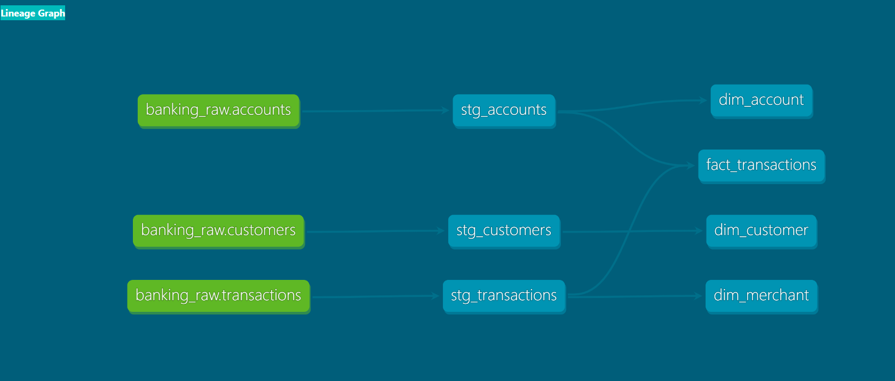
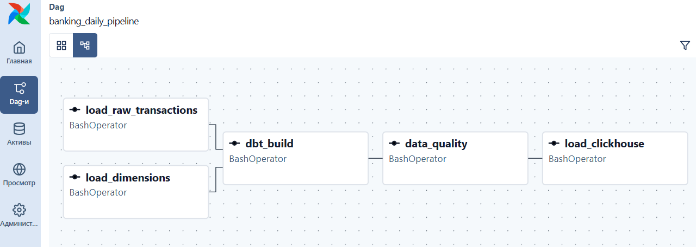

# Banking Data Platform

Проект Data Engineer для обработки банковских транзакций.

Проект показывает полный путь данных: от генерации событий и Kafka до хранилища, dbt, Airflow и аналитической базы.

## Архитектура

```text
Генератор транзакций
        ↓
      Kafka
        ↓
Kafka Consumer
        ↓
PostgreSQL OLTP
        ↓
Инкрементальный ETL
        ↓
PostgreSQL DWH
        ↓
       dbt
        ↓
Факты и измерения
        ↓
Проверки качества
        ↓
   ClickHouse
```

Airflow управляет последовательностью ETL, dbt, проверок качества и загрузки в ClickHouse.

## Технологии

- Python
- SQL
- PostgreSQL
- Kafka
- Airflow
- dbt
- ClickHouse
- Docker
- pytest

## Структура данных

Исходная OLTP-модель:

- `customers`
- `accounts`
- `cards`
- `transactions`

Слой RAW:

- `raw.customers`
- `raw.accounts`
- `raw.transactions`
- `raw.rejected_transactions`

Аналитический слой:

- `dim_customer`
- `dim_account`
- `dim_merchant`
- `fact_transactions`

## dbt

dbt используется для преобразования данных:

```text
RAW
 ↓
staging
 ↓
marts
```

В проекте используются проверки:

- `not_null`
- `unique`
- `relationships`
- `accepted_values`

### Граф зависимостей dbt



## Airflow

Основной DAG:

```text
load_raw_transactions ──┐
                        ├──> dbt_build
load_dimensions ────────┘
                             ↓
                        data_quality
                             ↓
                       load_clickhouse
```

### Airflow DAG



## Kafka

Основной поток:

```text
bank.transactions
```

Ошибочные сообщения направляются в:

```text
bank.transactions.dlq
```

Consumer использует ручное подтверждение offset и защищён от повторной вставки транзакций.

## ETL

Транзакции загружаются в DWH инкрементально по watermark.

Состояние загрузки хранится в:

```text
etl.pipeline_state
```

Каждый запуск записывается в:

```text
etl.pipeline_runs
```

Сохраняются:

- время начала и окончания;
- количество извлечённых строк;
- количество загруженных строк;
- количество отклонённых строк;
- статус запуска;
- текст ошибки.

## Контроль качества

Проверяются:

- пустые `transaction_id`;
- дубликаты;
- отрицательные суммы;
- отсутствующие клиенты;
- допустимые валюты;
- допустимые статусы;
- актуальность данных.

Ошибочные строки сохраняются в:

```text
raw.rejected_transactions
```

## Запуск проекта

Запуск контейнеров:

```bash
docker compose up -d
```

Проверка:

```bash
docker compose ps
```

Запуск Kafka Consumer:

```bash
python -m src.consumer.transaction_consumer
```

Запуск Kafka Producer:

```bash
python -m src.producer.kafka_producer
```

Ручной запуск ETL:

```bash
python -m src.etl.load
```

Запуск dbt:

```bash
cd dbt/banking_dwh
dbt build
```

Запуск тестов Python:

```bash
pytest -v
```

Airflow:

```text
http://localhost:8080
```

## Что показывает проект

Проект демонстрирует практическую работу с:

- потоковой загрузкой данных;
- пакетным ETL;
- инкрементальной загрузкой;
- watermark;
- DWH;
- схемой «звезда»;
- dbt;
- оркестрацией Airflow;
- качеством данных;
- Kafka DLQ;
- аудитом ETL;
- PostgreSQL и ClickHouse;
- Docker.

## Возможные улучшения

- CDC через Debezium;
- Schema Registry;
- инкрементальная загрузка в ClickHouse;
- CI/CD;
- мониторинг через Prometheus и Grafana;
- развёртывание в облаке.
